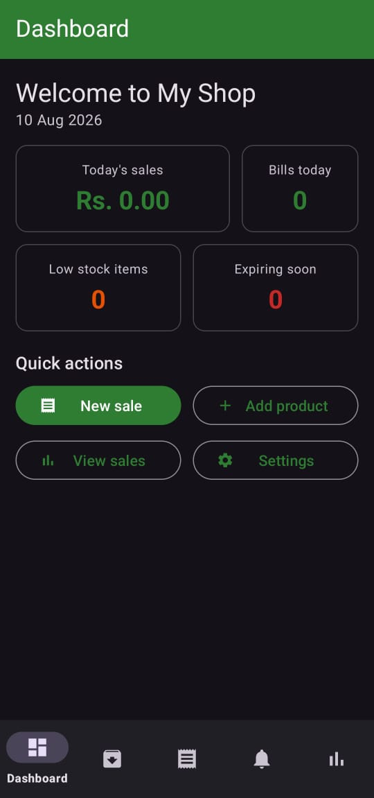
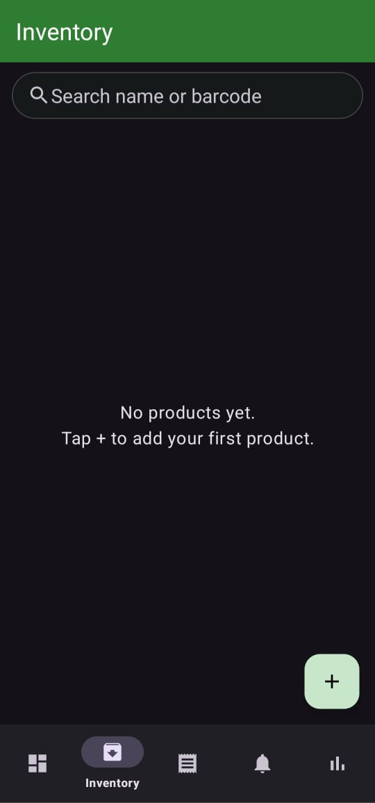
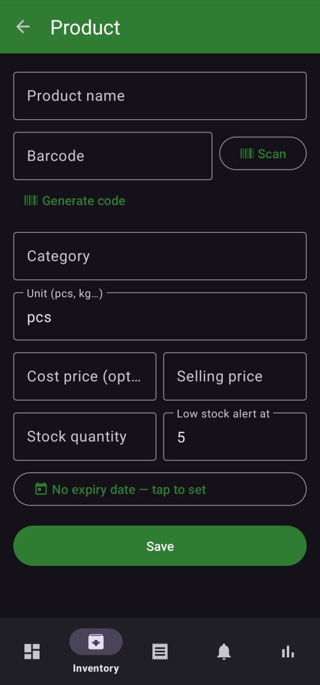
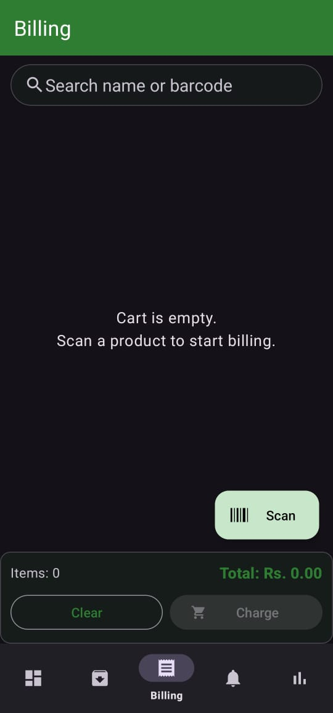
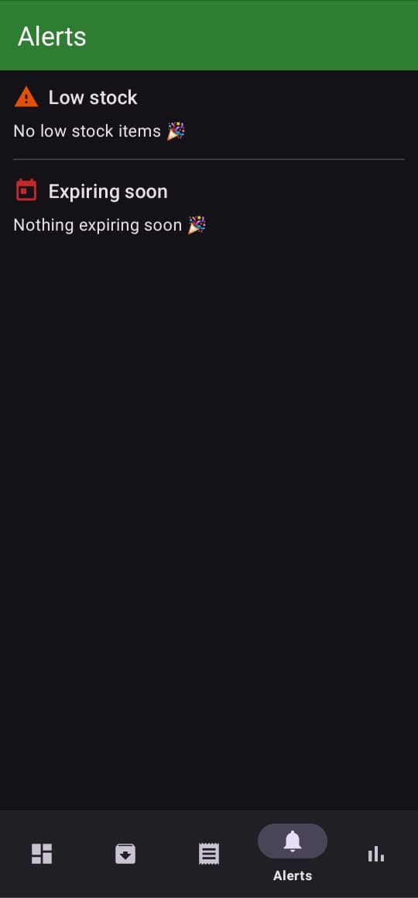
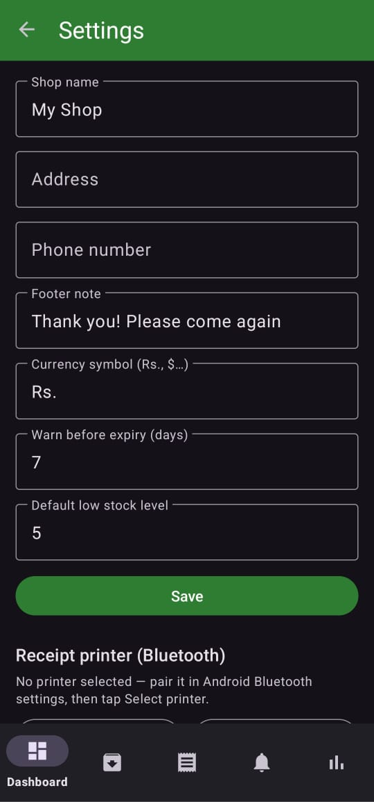
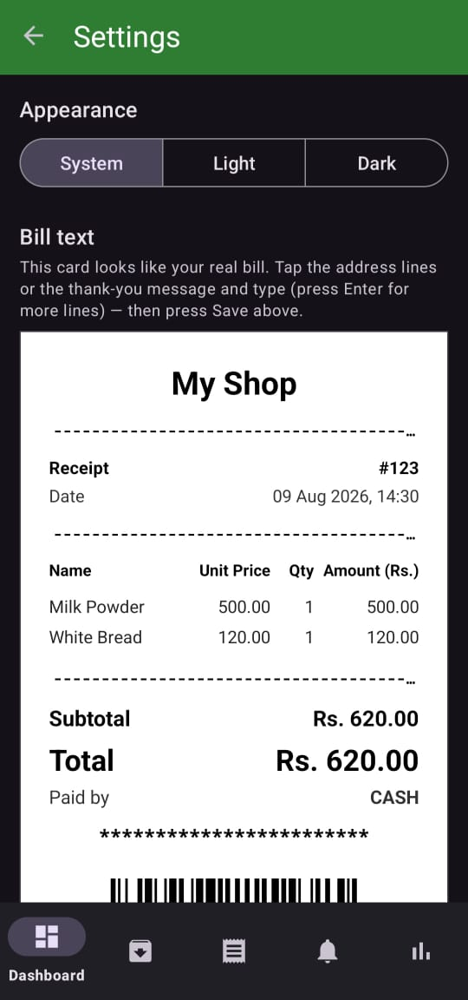

# ShopMate 🛍️

ShopMate is a modern, lightweight Point of Sale (POS) and Inventory Management app designed for small retail businesses. It provides a seamless experience for managing products, tracking sales, and generating professional receipts directly from an Android device.

## ✨ Features

- **📊 Smart Dashboard**: Real-time overview of today's sales, bill counts, and critical alerts (low stock & expiring items).
- **📦 Inventory Management**: Full CRUD operations for products with support for categories, units, cost prices, and selling prices.
- **🔍 Barcode Scanning**: Lightning-fast barcode scanning using **CameraX** and **Google ML Kit** for quick billing and inventory lookups.
- **🛒 Interactive Billing**: Add products via scanner or search, apply discounts, and choose between Cash or Card payment methods.
- **📄 Professional Receipts**:
    - **Thermal Printer Support**: Print receipts directly to Bluetooth ESC/POS thermal printers.
    - **Share as Photo**: Generate a high-quality "supermarket-style" receipt image to share via WhatsApp, email, or other apps.
    - **Barcode Integration**: Every receipt includes a scannable barcode for easy tracking.
- **⚠️ Smart Alerts**: Automatic notifications for products running low on stock or approaching their expiry date.
- **🎨 Modern UI**: Built with **Material 3**, featuring a clean, responsive design and full support for **Dark Mode**.
- **💾 Data Backup**: Export your inventory and sales data to CSV files for use in Excel or Google Sheets.

## 🛠️ Tech Stack

- **Language**: Kotlin
- **UI Framework**: Android XML with **Material 3**
- **Architecture**: MVVM (Model-View-ViewModel)
- **Local Database**: **Room** (SQLite) for offline-first reliable data storage.
- **Navigation**: Jetpack Navigation Component
- **Camera**: CameraX for robust barcode scanning.
- **AI/ML**: Google ML Kit (Barcode Scanning API).
- **Barcode Generation**: ZXing for creating unique in-store barcodes.
- **Asynchronous Work**: Kotlin Coroutines & Flow.

## 🚀 Getting Started

### Prerequisites
- Android Studio Ladybug (or newer).
- JDK 17.
- Android device running API 24 (Android 7.0) or higher.

### Installation
1. Clone the repository:
   ```bash
   git clone https://github.com/Shamika-WAD/ShopMate.git
   ```
2. Open the project in Android Studio.
3. Sync Project with Gradle Files.
4. Run the app on your device or emulator.

## ⚙️ Configuration
Go to the **Settings** tab in the app to:
- Set your Shop Name, Address, and Phone.
- Configure your local currency.
- Pair and select your Bluetooth Thermal Printer.
- Customize the footer message for your receipts.

## 📸 Screenshots

<p align="center">
  
  
  
</p>
<p align="center">
  
  
  
</p>
<p align="center">
  
</p>

---
Developed with ❤️ for small businesses.
